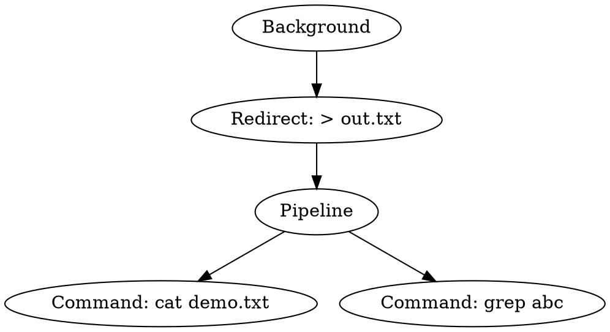

# Grammar-Based Parsing and Abstract Syntax Trees

## Overview

This design replaces the ad-hoc pipeline parser in AiShell with a real
lexer → parser → AST → executor pipeline, adds environment variable
assignment and expansion, and adds an AST visualization mode for demos.

---

## Architecture: Old vs New

### Earlier flow (ad-hoc parser)

```
input string
  → tokenize_line()          (token.c)     produces token_t[]
  → parse_pipeline()         (exec.c)      ad-hoc if/else → segment_t[]
  → expand_globs()                         glob-expands each argv
  → run_pipeline() / builtin dispatch
```

`parse_pipeline()` was a flat loop: it walked the token array and
accumulated a `segment_t` struct, switching on token types inline.
There was no intermediate representation — tokens mapped directly to
execution slots.

### Current flow (grammar-based parser)

```
input string
  → tokenize_line()          (token.c)     produces token_t[]
  → parse_input()            (parser.c)    grammar-based → ast_node_t*
  → [ast_print_text()]       (ast_print.c) optional: print text tree
  → [ast_write_dot()]        (ast_print.c) optional: write ast.dot
  → execute_ast()            (exec.c)      walk AST → run_pipeline()
      → expand_env()                       $VAR expansion per word
      → expand_globs()                     glob expansion
      → run_pipeline() / builtin dispatch  (unchanged from the earlier flow)
```

The parser produces a tree of `ast_node_t` nodes before any execution.
This makes the structure of the command visible and separates parsing
concerns cleanly from execution concerns.

---

## Grammar

```
inputline      ::= assignment | command background_opt
background_opt ::= '&' | empty

command        ::= pipeline redirection_list
pipeline       ::= simple_command ('|' simple_command)*
simple_command ::= WORD WORD*

redirection_list ::= redirection*
redirection    ::= '>' WORD
                 | '>>' WORD
                 | '<' WORD

assignment     ::= NAME '=' VALUE   (single token, NAME is a valid identifier)
```

---

## AST Node Types

| Node type        | Fields                                    | Meaning                        |
|------------------|-------------------------------------------|--------------------------------|
| `AST_COMMAND`    | `argv[]`, `argc`                          | Simple command with arguments  |
| `AST_PIPELINE`   | `stages[]`, `count`                       | Two or more piped commands     |
| `AST_REDIRECT`   | `child`, `redir_type`, `filename`         | Wraps a command/pipeline       |
| `AST_BACKGROUND` | `child`                                   | Wraps a command to run with `&`|
| `AST_ASSIGNMENT` | `name`, `value`                           | NAME=VALUE environment setter  |

Redirect and Background nodes **wrap** their children; the tree reflects
the grammar nesting, not execution order.

### Example

Input: `cat file.txt | grep abc > out.txt &`

```
Background
└── Redirect(> out.txt)
    └── Pipeline
        ├── Command: cat file.txt
        └── Command: grep abc
```

---

## New Features

### Environment variable assignment

A line consisting of a single `NAME=VALUE` token is treated as an
assignment rather than a command:

```
NAME=hello
echo $NAME        → hello
```

Implementation: `parse_input()` detects the pattern and creates an
`AST_ASSIGNMENT` node.  `execute_ast()` calls `setenv(name, value, 1)`.

### Variable expansion (`$NAME` and `${NAME}`)

Before executing any command, `expand_env()` scans each argv word for
`$NAME` or `${NAME}` patterns and replaces them with `getenv(NAME)` (or
the empty string if unset).  Expansion also applies to redirection
filenames.

```
OUTFILE=/tmp/result.txt
echo hello > $OUTFILE
cat $OUTFILE          → hello
```

### Improved syntax error messages

The parser produces specific error messages instead of crashing or
silently misbehaving:

| Bad input        | Error message                              |
|------------------|--------------------------------------------|
| `ls \|`          | `syntax error: expected command after \|`  |
| `echo hi >`      | `syntax error: expected filename after '>'`|
| `echo hi >>`     | `syntax error: expected filename after '>>'`|
| `cmd & extra`    | `syntax error: unexpected token after &`   |

---

## AST Debug Mode

When AST debug mode is active, every command prints a text tree and
writes `ast.dot` **before** executing.  This visually proves that
grammar-based parsing is happening.

### Enable methods

| Method                         | Effect                        |
|--------------------------------|-------------------------------|
| `AISHELL_AST=1 ./aishell`      | Environment variable          |
| `./aishell --ast`              | Command-line flag             |
| `ast on` (inside the shell)    | Built-in toggle               |
| `ast off` (inside the shell)   | Disable                       |
| `ast` (no argument)            | Show current state            |

### Example session

```
$ AISHELL_AST=1 ./aishell
aishell> echo hello
--- AST ---
Command: echo hello
-----------
hello

aishell> cat demo.txt | grep abc > out.txt &
--- AST ---
Background
└── Redirect(> out.txt)
    └── Pipeline
        ├── Command: cat demo.txt
        └── Command: grep abc
-----------
[1] 4321
```

### DOT file format

Every command writes `ast.dot` in the current directory.  Example:



### Generating a PNG

If [Graphviz](https://graphviz.org/) is installed:

```bash
dot -Tpng ast.dot -o ast.png
open ast.png          # macOS
xdg-open ast.png      # Linux
```

Install Graphviz on macOS:

```bash
brew install graphviz
```

When Graphviz is available, `execute_line()` also attempts this
automatically (errors are silenced so the shell works fine without it).

---

## New Source Files

| File                        | Purpose                                    |
|-----------------------------|--------------------------------------------|
| `src/ast.h` / `src/ast.c`  | AST node type definitions and constructors |
| `src/parser.h` / `src/parser.c` | Recursive-descent parser              |
| `src/ast_print.h` / `src/ast_print.c` | Text tree + Graphviz DOT output |
| `src/builtins/astmode.c`   | `ast` built-in command (on/off toggle)     |

### Modified files

| File           | Change                                                 |
|----------------|--------------------------------------------------------|
| `src/exec.c`   | `execute_line()` now uses parser+AST; added `execute_ast()`, `expand_env()`, `ast_to_segments()`; removed `parse_pipeline()` |
| `src/exec.h`   | Exposes `g_ast_debug`, `execute_ast()`                |
| `src/main.c`   | Handles `--ast` flag, `AISHELL_AST` env var, registers `ast` builtin |
| `Makefile`     | Added new source files                                |

---

## Demo Script

```bash
bash scripts/demo_ast.sh
```

The script starts AiShell with `AISHELL_AST=1` and runs a sequence of
commands illustrating:
- simple command → `Command` node
- pipeline → `Pipeline` node
- redirection over pipeline → `Redirect` wrapping `Pipeline`
- background job → `Background` node
- environment variable assignment and expansion
- combined: redirect + background + variable expansion
- syntax error handling

---

## Tests

```bash
bash tests/test_ast.sh
```

Verifies 25 cases across: basic commands, pipelines, redirections,
background jobs, environment variables, syntax errors, AST debug mode,
DOT file generation, and non-regression of existing builtins.

---

## Job Control: Ctrl+C and Process Groups

### Why Ctrl+C was killing background jobs (the bug)

Before this fix, every forked child (foreground or background) inherited
the shell's process group.  The terminal always sends `SIGINT` to the
**foreground process group**, which was the shell's group.  All children
were in that group, so Ctrl+C killed both foreground *and* background
jobs.  The shell itself survived only because it had `SIGINT` set to
`SIG_IGN`.

### How the fix works

**Shell startup (interactive mode only)**

```
setpgid(0, 0)               → shell becomes its own process group leader
g_shell_pgid = getpgrp()    → remember the shell's pgid
tcsetpgrp(STDIN_FILENO, g_shell_pgid)  → take terminal ownership
signal(SIGTTOU, SIG_IGN)    → don't stop the shell during terminal ops
signal(SIGTTIN, SIG_IGN)    → same
signal(SIGTSTP, SIG_IGN)    → Ctrl+Z won't stop the shell
```

**Every forked job (`run_pipeline()`)**

```
child  side:  setpgid(0, 0 or pgid)   → move into own process group
parent side:  setpgid(child, pgid)    → mirror, to close the race window
```

Both the child and the parent call `setpgid()` because there is a race
between `fork()` returning and either side executing `setpgid()`.
Whichever side wins, the child ends up in the right group before any
signal can be delivered.

**Foreground jobs** additionally transfer terminal control:

```
tcsetpgrp(STDIN_FILENO, pgid)         → job's group becomes terminal foreground
... waitpid() ...
tcsetpgrp(STDIN_FILENO, g_shell_pgid) → shell takes terminal back
```

**Background jobs** only call `setpgid()`; they never get terminal
control, so Ctrl+C (SIGINT to the *current* foreground group) cannot
reach them.

### Signal disposition in children

Every child process resets these signals to `SIG_DFL` before exec:

| Signal   | Reason                                                    |
|----------|-----------------------------------------------------------|
| SIGINT   | Let Ctrl+C kill foreground jobs                           |
| SIGQUIT  | Let Ctrl+\\ kill foreground jobs                          |
| SIGTSTP  | Let Ctrl+Z stop foreground jobs                           |
| SIGCHLD  | Don't inherit the shell's SIGCHLD handler                 |
| SIGTTOU  | Allow writes to the terminal (was SIG_IGN in shell)       |
| SIGTTIN  | Allow reads from the terminal (was SIG_IGN in shell)      |

The same resets apply in `run_external_interactive()` (used by the
`sleep`, `vi`, and `less` builtin wrappers).

### Manual verification

Start the shell interactively:

```
./aishell
```

**Case A — Background jobs survive Ctrl+C at the prompt**

```
aishell> sleep 100 &
[1] <pid>
aishell> sleep 200 &
[2] <pid>
aishell> jobs
[1] <pid> running   sleep
[2] <pid> running   sleep

  (press Ctrl+C here)

aishell> jobs
[1] <pid> running   sleep     ← still alive
[2] <pid> running   sleep     ← still alive
```

**Case B — Foreground job dies on Ctrl+C**

```
aishell> sleep 100
  (press Ctrl+C)
^C
aishell>                      ← prompt returns; sleep is gone
```

**Case C — Foreground pipeline dies on Ctrl+C**

```
aishell> sleep 100 | cat
  (press Ctrl+C)
^C
aishell>                      ← both sleep and cat are gone
```

**Case D — AST debug mode still works with background jobs**

```
AISHELL_AST=1 ./aishell
aishell> cat /dev/null | grep x > /tmp/out.txt &
--- AST ---
Background
└── Redirect(> /tmp/out.txt)
    └── Pipeline
        ├── Command: cat /dev/null
        └── Command: grep x
-----------
[1] <pid>
```

### Files changed

| File              | Change                                                          |
|-------------------|-----------------------------------------------------------------|
| `src/exec.h`      | Added `extern pid_t g_shell_pgid`                              |
| `src/exec.c`      | Added `g_shell_pgid`; rewrote `run_pipeline()` with `setpgid()` / `tcsetpgrp()` |
| `src/main.c`      | Interactive startup: `setpgid`, `tcsetpgrp`, ignore SIGTTOU/SIGTTIN/SIGTSTP |
| `src/command.c`   | `run_external_interactive()`: reset SIGQUIT/SIGTSTP/SIGTTOU/SIGTTIN in child |
